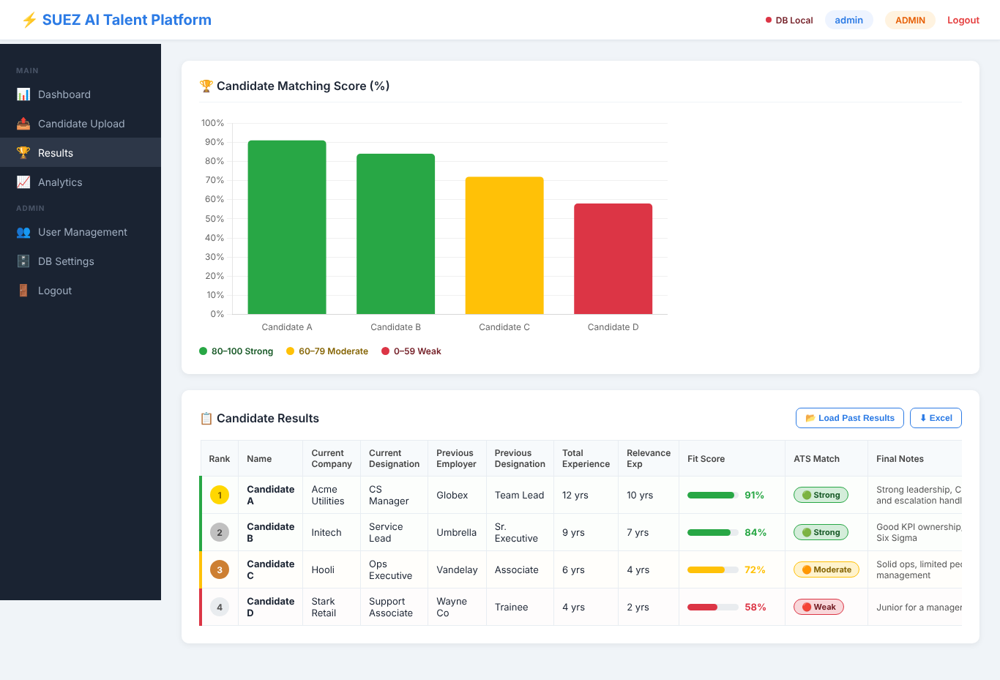
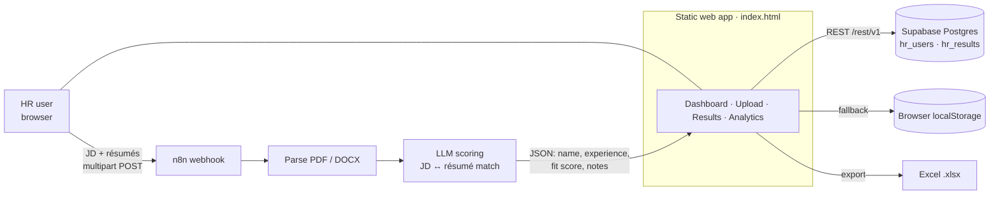
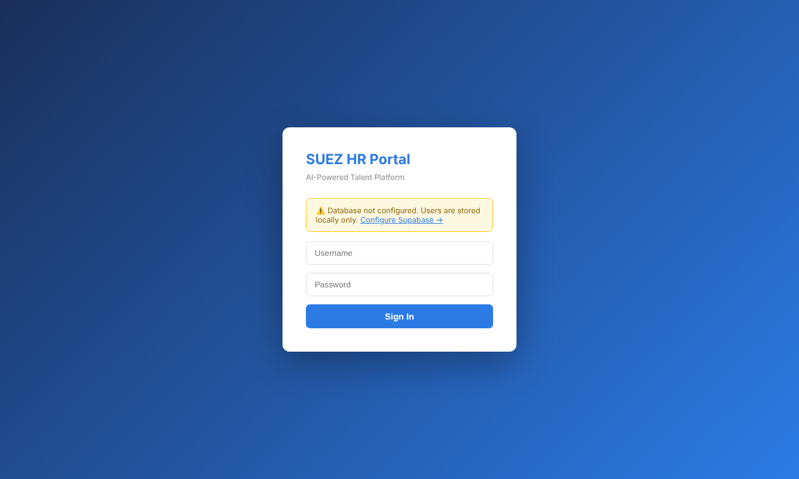
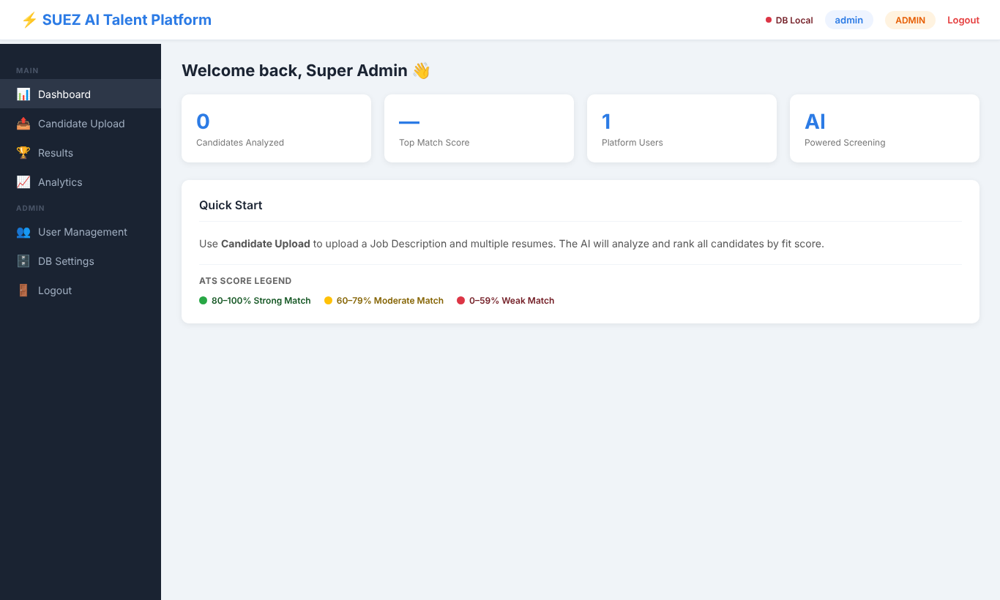

# AI Resume Screening App

An AI-powered talent screening web app for HR teams. Upload a job description and a batch of résumés. The app sends them to an **n8n + LLM workflow**, scores each candidate's fit for the role, ranks them, and shows the results in a dashboard with charts and an Excel export.



## ✨ Features

- **Bulk screening**: one job description plus many résumés (PDF/DOCX) in a single run
- **AI fit score**: every candidate gets an overall fit score (0–100%) and an ATS match band
  - 🟢 Strong: 80–100%
  - 🟡 Moderate: 60–79%
  - 🔴 Weak: under 60%
- **Ranked results**: a ranked table showing current and previous employer, designation, total and relevant experience, and AI notes
- **Analytics**: a bar chart of candidate scores (Chart.js)
- **Excel export**: download the results as `.xlsx` (SheetJS)
- **User management**: admin and user roles; add, edit, delete and reset passwords
- **Persistence**: data is saved to Supabase (Postgres), or to the browser's localStorage when no database is configured
- **No build step**: a single static `index.html` that you can host on GitHub Pages, Netlify or any web server

## 🏗️ Architecture



**How it flows**
1. The user signs in. Users are stored in the Supabase table `hr_users`, or in localStorage as a fallback.
2. The user uploads one job description and N résumés. The browser posts them to the n8n webhook.
3. The n8n workflow extracts the text, prompts the LLM to compare each résumé with the job description, and returns structured JSON.
4. The frontend normalises the scores, ranks the candidates, draws the chart and saves the run to `hr_results`.

## 🖼️ Screenshots

| Login | Dashboard | Results |
|---|---|---|
|  |  |  |

*The screenshots use sample data. Candidate names are fictional.*

## 🧰 Tech stack

| Layer | Technology |
|---|---|
| Frontend | HTML5, CSS3, vanilla JavaScript |
| Charts / export | Chart.js, SheetJS (xlsx) |
| AI pipeline | n8n workflow + LLM |
| Database | Supabase (PostgreSQL + REST) |
| Hosting | Any static host (GitHub Pages / Netlify) |

## 🚀 Getting started

```bash
git clone https://github.com/Mayur96k/resume-screening-app.git
cd resume-screening-app
cp config.example.js config.js   # then fill in your values
python3 -m http.server 8000      # open http://localhost:8000
```

### Configuration (`config.js`)

`config.js` is **git-ignored**. Never commit real keys.

```js
window.APP_CONFIG = {
  SUPABASE_URL: 'https://YOUR-PROJECT.supabase.co',
  SUPABASE_ANON_KEY: 'YOUR_SUPABASE_ANON_KEY',
  N8N_WEBHOOK_URL: 'https://YOUR-N8N-HOST/webhook/YOUR-WEBHOOK-ID'
};
```

If you leave Supabase empty, the app runs in **local mode** and stores data in the browser.

### Database setup

Create the `hr_users` and `hr_results` tables with the SQL shown in the app under **DB Settings → Copy SQL**. Then turn on **Row Level Security** for both tables.

## 🔐 Security notes

- No secrets are hard-coded. All endpoints and keys come from `config.js`.
- The Supabase anon key is meant to be used in browsers, so it's only safe when **Row Level Security** policies are in place.
- Change the default local admin account (`admin` / `admin123`) before you use the app for real.
- For production, use **Supabase Auth** instead of storing passwords in a table.

## 📁 Project structure

```
resume-screening-app/
├── index.html            # Complete single-page app
├── config.example.js     # Configuration template (copy to config.js)
├── docs/screenshots/     # README images
└── README.md
```

## 🗺️ Roadmap

- [ ] Move authentication to Supabase Auth
- [ ] Commit the n8n workflow JSON so the AI pipeline can be rebuilt
- [ ] Skill-gap breakdown per candidate
- [ ] Live demo on GitHub Pages

## 👤 Author

**Mayur Jagtap** · [GitHub](https://github.com/Mayur96k)

## 📄 License

[MIT](LICENSE)
